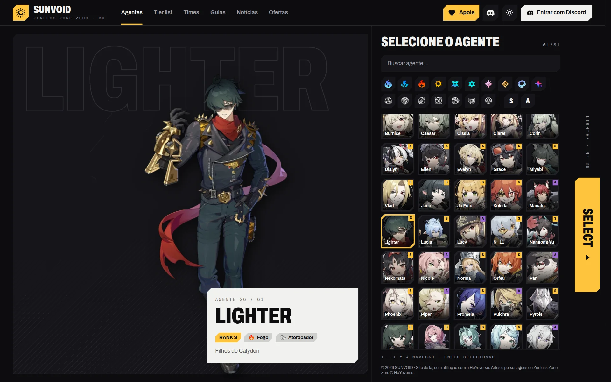
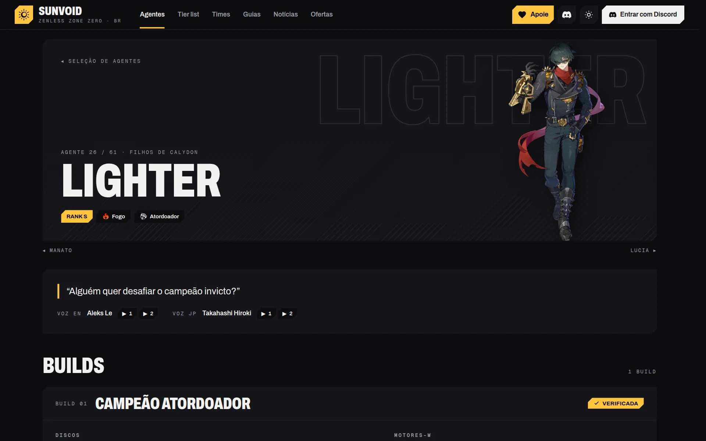
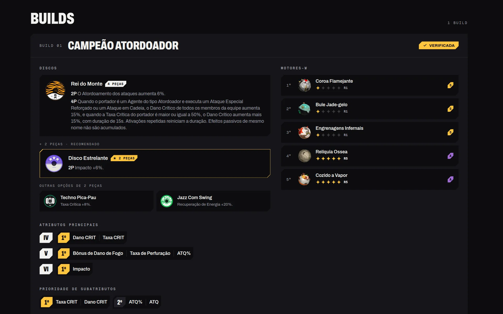
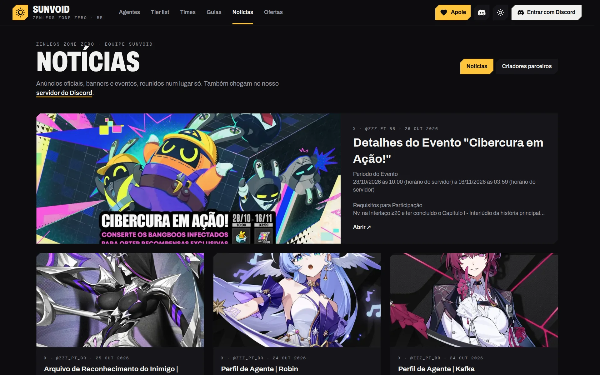
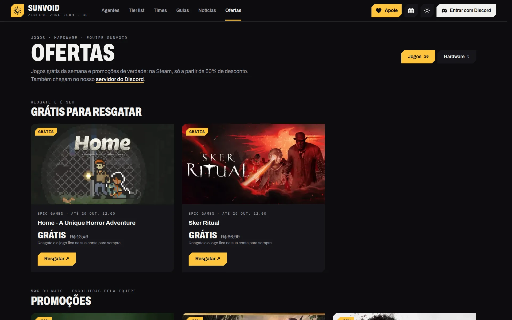
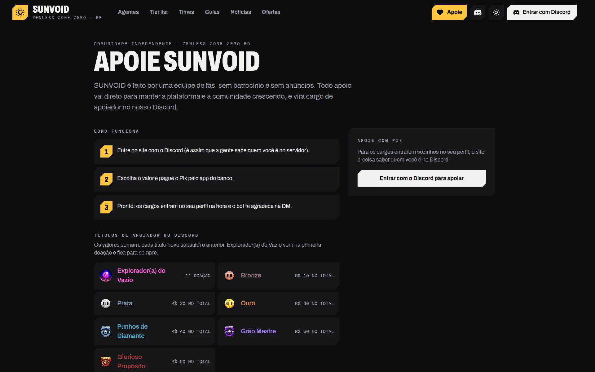
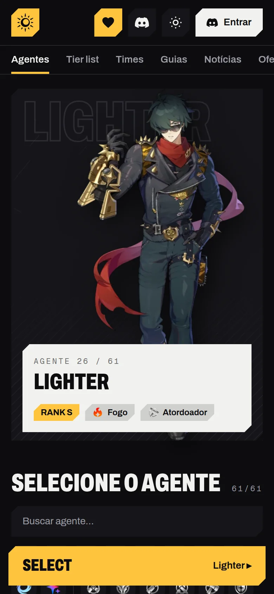
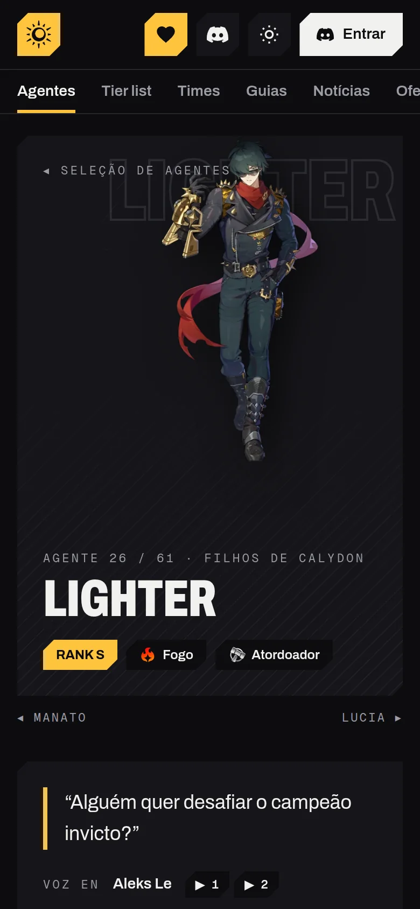
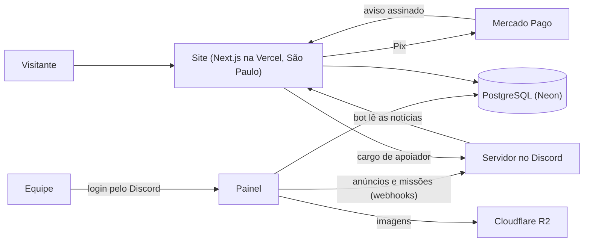

# SUNVOID

> **Vitrine do projeto.** O código é privado. A plataforma está no ar em **[sunvoid.com.br](https://sunvoid.com.br)**; aqui estão o problema, a solução, as telas e as decisões de arquitetura.

*English summary: SUNVOID is the Brazilian community for Zenless Zone Zero, and this is its platform: agent builds, a tier list with an open scoring formula, team compositions, guides, news, deals and Pix donations. Sign-in is Discord-only, and the site and the Discord server work as one (roles, announcements, news import, support tickets). Next.js, Neon Postgres, Better Auth, Cloudflare R2, Vercel.*

## O problema
SUNVOID nasceu como servidor no Discord, no lançamento do jogo, e ganhou um site que era só uma ferramenta de builds. A equipe editava tudo direto no console do banco de dados, sem painel, sem revisão e sem histórico. Notícias, cargos e avisos viviam no Discord, separados do site.

## A solução
Uma plataforma completa, com um painel para a equipe e o Discord como parte do produto:

- **Agentes e builds:** a seleção estilo jogo de luta e a página de cada agente, com builds verificadas pela equipe (discos, motores-W e atributos), habilidades e a ordem de evolução.
- **Tier list com o cálculo aberto:** cada agente ganha uma nota de 0 a 100 a partir de cinco critérios, e quem visita vê de onde veio cada ponto. A equipe ajusta no painel, vê a prévia ao vivo e só então publica.
- **Times, guias e notícias:** composições com substitutos para cada vaga, guias escritos num editor visual e as notícias oficiais reunidas num lugar só, junto com os vídeos dos criadores parceiros.
- **Ofertas:** jogos grátis e promoções de verdade. Os grátis da Epic e as promoções grandes da Steam chegam sozinhos, e quem quiser recebe um resumo semanal por e-mail.
- **Apoio com Pix:** quem apoia entra com o Discord, paga o Pix e recebe o cargo de apoiador na hora, com agradecimento automático.

## Telas
> O site no ar, no tema escuro. Também existe o tema claro, que é o padrão.

### Seleção de agentes
O retrato grande, a ficha do agente e a grade com busca e filtros por atributo, especialidade e rank. Dá para navegar pelas setas do teclado e entrar com Enter.

### Página do agente
Retrato, fala e vozes oficiais (em inglês e japonês), trazidos do site oficial do jogo com um clique no painel.

### Builds verificadas
Discos com o conjunto recomendado em destaque, motores-W com o refinamento indicado, atributos principais e a prioridade dos subatributos.

### Notícias
As notícias oficiais do jogo chegam do próprio servidor no Discord: o bot lê o canal e a notícia aparece no site.

### Ofertas
Jogos grátis para resgatar e promoções escolhidas pela equipe, com prazo e preço.

### Apoie SUNVOID
O Pix sai do Mercado Pago, e o pagamento é confirmado sozinho. O cargo de apoiador muda conforme o valor acumulado.

### No celular

  
  &nbsp;
  

## Arquitetura

## Decisões que valem destacar
- **Login só pelo Discord.** A comunidade já vive lá. Quem entra no site já é reconhecido no servidor, então cargos, apoio e permissões andam juntos, sem senha nova para ninguém.
- **Papéis e histórico.** Comunidade, editor, revisor e administrador, cada um com o que pode fazer no painel. Toda alteração fica registrada, com quem fez e quando.
- **O que é publicado é uma foto.** A tier list que o site mostra é a última versão publicada. A equipe mexe à vontade no painel, vê a prévia e o que mudaria, e só então publica.
- **Pagamento confirmado por dois caminhos.** O aviso do Mercado Pago chega assinado e é conferido antes de valer. Ao mesmo tempo, a página consulta o pedido, então o cargo sai mesmo se o aviso atrasar.
- **Conteúdo oficial sem trabalho braçal.** Retratos, vozes, emblemas e ícones vêm das fontes oficiais com um botão no painel, já no tamanho certo. As habilidades chegam em português, com o inglês de referência.
- **Perto de quem usa.** O site roda na região de São Paulo da Vercel, e as imagens ficam no Cloudflare R2.

## Stack
Next.js 16 (App Router) · React 19 · TypeScript · Tailwind CSS 4 · Neon (PostgreSQL) · Drizzle ORM · Better Auth (Discord) · Cloudflare R2 · Tiptap · Mercado Pago (Pix) · Vercel

## Meu papel
Criei SUNVOID no lançamento do jogo. Idealizei, desenhei e desenvolvi a plataforma inteira, da identidade visual à integração com o Discord, e sou o administrador.
